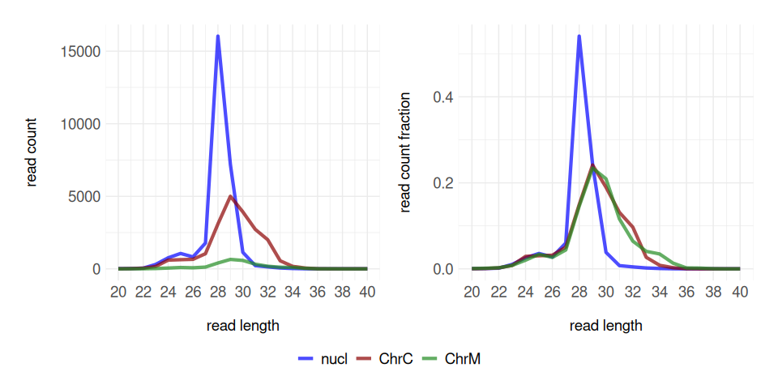
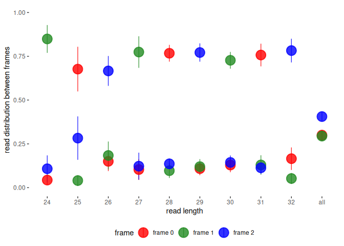
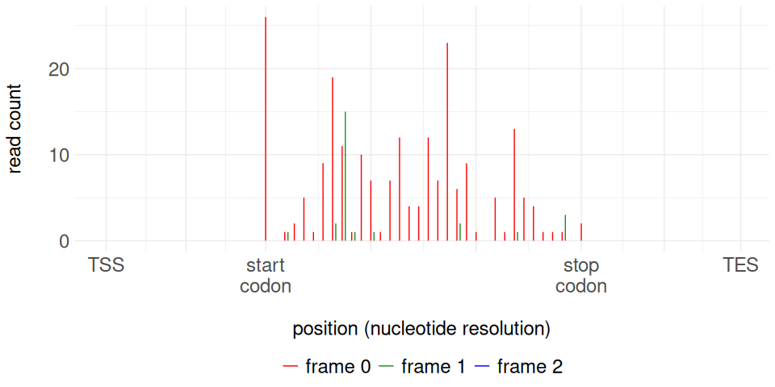

RiboseQC: quality control of Ribo-seq data
================
Katarina Gresova

- [Introduction](#introduction)
- [Example data](#example-data)
- [Prepare the annotation](#prepare-the-annotation)
- [Analyse the BAM files](#analyse-the-bam-files)
- [Read lengths and compartments](#read-lengths-and-compartments)
- [P-site offsets](#p-site-offsets)
- [The HTML report](#the-html-report)
- [P-sites for ORFquant](#p-sites-for-orfquant)
- [Running RiboseQC on your own
  data](#running-riboseqc-on-your-own-data)
- [References](#references)
- [Session info](#session-info)

## Introduction

*RiboseQC* analyses Ribo-seq data \[1\] for each read length, in the
genomic regions where the reads map (CDS, UTRs, introns, non-coding RNAs
and intergenic regions) and in each compartment of the cell: the nuclear
genome, and the circular genomes of organelles such as mitochondria and
chloroplasts. It calculates the P-site offset of each read length,
selects the read lengths whose reads show the reading frame, gives their
P-sites, and creates an HTML report that compares samples \[2\].

This vignette runs the two steps of an analysis on the small example
data included in the package:

1.  `prepare_annotation_files()`: parse the annotation and link it to
    the genome sequence, once per annotation;
2.  `RiboseQC_analysis()`: analyse one or more BAM files with this
    annotation.

Then it shows some of the results, with the functions that make the
plots of the HTML report.

``` r
library(RiboseQC)
```

## Example data

The example data are Ribo-seq reads from roots and shoots of
*Arabidopsis thaliana* \[3\], on 309 genes: 99 on the five nuclear
chromosomes, 88 on the chloroplast genome (`ChrC`) and 122 on the
mitochondrial genome (`ChrM`).

- `simp_arab.gtf.gz`: the annotation of these genes, from Araport11
  \[4\];
- `simp_arab.fa.gz`: the genome sequence (TAIR10 \[5\]), with the bases
  away from these genes replaced by N (99.6% of the genome), compressed
  with `bgzip` and indexed;
- `simp_arab_root.bam` and `simp_arab_shoots.bam`: the Ribo-seq reads of
  a root and a shoot sample, aligned to the genome, with their indexes;
- `root_results_RiboseQC`: the results of `RiboseQC_analysis()` on the
  root sample, which the examples of the help pages use;
- `README.md`: the sources of these files, their terms of use and the
  papers to cite.

``` r
ext_data <- system.file("ext_data", package = "RiboseQC")
list.files(ext_data)
#>  [1] "README.md"                "root_results_RiboseQC"   
#>  [3] "simp_arab_root.bam"       "simp_arab_root.bam.bai"  
#>  [5] "simp_arab_shoots.bam"     "simp_arab_shoots.bam.bai"
#>  [7] "simp_arab.fa.gz"          "simp_arab.fa.gz.fai"     
#>  [9] "simp_arab.fa.gz.gzi"      "simp_arab.gtf.gz"
```

All output files go to a temporary directory:

``` r
out_dir <- file.path(tempdir(), "RiboseQC_example")
dir.create(out_dir)
```

## Prepare the annotation

`prepare_annotation_files()` reads a GTF file and the genome sequence,
and writes a *TxDb* and an `_Rannot` file to `annotation_directory`. The
`_Rannot` file holds the annotated features (transcripts, exons, CDS,
UTRs, introns, start and stop codons, …) that `RiboseQC_analysis()`
uses, and refers to the genome sequence by its path. The genome sequence
must be a FASTA file that *Rsamtools* can read: uncompressed, or
compressed with `bgzip`, as the example one.

``` r
annotation_file <- prepare_annotation_files(annotation_directory = out_dir,
                                            gtf_file = file.path(ext_data, "simp_arab.gtf.gz"),
                                            genome_seq = file.path(ext_data, "simp_arab.fa.gz"))
```

(*txdbmaker* warns that some CDS phases are missing and that the *TxDb*
has no genome version; *RiboseQC* uses neither.)

`load_annotation()` loads the annotation into two variables of the
environment that calls it: `GTF_annotation`, a list of the annotated
features, and `genome_seq`, the genome sequence. `RiboseQC_analysis()`
loads the annotation itself; here we only look at it. The chloroplast
and mitochondrial genomes are circular, and each circular chromosome is
a compartment of its own in the analysis. `genetic_codes` gives the
genetic code of each chromosome, here the standard code (`1`) for all:

``` r
load_annotation(annotation_file)
GTF_annotation$genetic_codes
#>      seqlengths isCircular genome genetic_code
#> ChrC     154478       TRUE   <NA>            1
#> ChrM     366924       TRUE   <NA>            1
#> Chr4   18585056      FALSE   <NA>            1
#> Chr2   19698289      FALSE   <NA>            1
#> Chr3   23459830      FALSE   <NA>            1
#> Chr5   26975502      FALSE   <NA>            1
#> Chr1   30427671      FALSE   <NA>            1
```

## Analyse the BAM files

`RiboseQC_analysis()` reads each BAM file in chunks of `chunk_size`
alignments (with `n_cores` above 1, it analyses the chunks in parallel),
and writes its output files with the prefix given in `dest_names`. Then,
with `create_report = TRUE` (the default), it creates one HTML report of
all samples. The report includes all plots, so it is large (about 60 MB
for these two samples); here we create no report.

``` r
RiboseQC_analysis(annotation_file = annotation_file,
                  bam_files = file.path(ext_data, c("simp_arab_root.bam", "simp_arab_shoots.bam")),
                  dest_names = file.path(out_dir, c("root", "shoots")),
                  sample_names = c("root", "shoots"),
                  create_report = FALSE)
```

``` r
list.files(out_dir, pattern = "^(root|shoots)_")
#>  [1] "root_coverage_minus.bedgraph"        "root_coverage_plus.bedgraph"        
#>  [3] "root_coverage_uniq_minus.bedgraph"   "root_coverage_uniq_plus.bedgraph"   
#>  [5] "root_for_ORFquant"                   "root_junctions"                     
#>  [7] "root_P_sites_calcs"                  "root_P_sites_minus.bedgraph"        
#>  [9] "root_P_sites_offsets.tsv"            "root_P_sites_plus.bedgraph"         
#> [11] "root_P_sites_uniq_minus.bedgraph"    "root_P_sites_uniq_plus.bedgraph"    
#> [13] "root_results_RiboseQC"               "root_results_RiboseQC_all"          
#> [15] "shoots_coverage_minus.bedgraph"      "shoots_coverage_plus.bedgraph"      
#> [17] "shoots_coverage_uniq_minus.bedgraph" "shoots_coverage_uniq_plus.bedgraph" 
#> [19] "shoots_for_ORFquant"                 "shoots_junctions"                   
#> [21] "shoots_P_sites_calcs"                "shoots_P_sites_minus.bedgraph"      
#> [23] "shoots_P_sites_offsets.tsv"          "shoots_P_sites_plus.bedgraph"       
#> [25] "shoots_P_sites_uniq_minus.bedgraph"  "shoots_P_sites_uniq_plus.bedgraph"  
#> [27] "shoots_results_RiboseQC"             "shoots_results_RiboseQC_all"
```

`<dest_name>_results_RiboseQC_all` holds all results, in the list
`res_all`; the *Details* section of `?RiboseQC_analysis` describes its
elements. `<dest_name>_results_RiboseQC` is a smaller copy of it,
without the P-sites, which the HTML report uses, and so do we here:

``` r
root <- get(load(file.path(out_dir, "root_results_RiboseQC")))
shoots <- get(load(file.path(out_dir, "shoots_results_RiboseQC")))
names(shoots)
#> [1] "read_stats"        "profiles_fivepr"   "selection_cutoffs"
#> [4] "P_sites_stats"     "profiles_P_sites"  "sequence_analysis"
#> [7] "summary_P_sites"
```

## Read lengths and compartments

`read_stats$positions` counts the reads in each genomic region and
compartment. As expected for green tissue, the shoot sample has many
more reads on the chloroplast genome than the root sample:

``` r
sapply(list(root = root, shoots = shoots), function(x) colSums(x$read_stats$positions))
#>             root shoots
#> reads_nucl 18496  29868
#> reads_ChrC  1980  22330
#> reads_ChrM  6887   2824
shoots$read_stats$positions
#>            reads_nucl reads_ChrC reads_ChrM
#> cds              7056      20705       2762
#> fiveutrs           87          0         17
#> threeutrs          55          0          0
#> ncIsof              0          0          0
#> ncRNAs              0          0          0
#> introns            95          3          3
#> intergenic      22575       1622         42
```

Most reads of the organelles are on CDS. The example BAM files also have
reads outside the 309 genes of the example annotation, so here many
reads of the nuclear genome are intergenic.

The plot functions of the report draw the same data. (They use the
`size` aesthetic for lines, which *ggplot2* 3.4.0 deprecated; this
vignette hides these warnings.) The read length distribution of each
compartment shows that the chloroplast ribosomes protect fragments of
more lengths than the cytoplasmic ribosomes (`nucl`):

``` r
plot_read_length_dist(shoots$read_stats$rld, "shoots")
```



## P-site offsets

For each compartment and read length, `RiboseQC_analysis()` calculates
the P-site offset (`cutoff`, the distance of the P-site from the read’s
5’ end) from the 5’ ends of the reads around start codons. Then it
selects the read lengths with in-frame signal, as
`readlength_choice_method` says (by default `"max_coverage"`).
`<dest_name>_P_sites_offsets.tsv` has the offsets of the selected read
lengths, which it used for the P-sites:

``` r
read.delim(file.path(out_dir, "root_P_sites_offsets.tsv"))
#>   read_length cutoff compartment
#> 1          28     12        nucl
read.delim(file.path(out_dir, "shoots_P_sites_offsets.tsv"))
#>    read_length cutoff compartment
#> 1           28     12        nucl
#> 2           24     14        ChrC
#> 3           32     16        ChrC
#> 4           27     11        ChrC
#> 5           29     13        ChrC
#> 6           28     12        ChrC
#> 7           31     15        ChrC
#> 8           30     14        ChrC
#> 9           25     15        ChrC
#> 10          26     10        ChrC
```

In both samples, the 28-nt reads of the cytoplasmic ribosomes have the
offset 12. In the shoot sample, 9 read lengths of the chloroplast are
selected too. No read length of the mitochondrion is selected, in either
sample. `<dest_name>_P_sites_calcs` has more data on each read length,
such as its frame preference, its percentage of the reads of its
compartment (`pct_map`), and for each method of
`readlength_choice_method` if it selects the read length. Some of its
columns:

``` r
calcs <- read.delim(file.path(out_dir, "shoots_P_sites_calcs"))
calcs[, c("comp", "read_length", "cutoff", "frame_preference", "pct_map", "max_coverage")]
#>    comp read_length cutoff frame_preference pct_map max_coverage
#> 1  nucl          28     12         91.66629 30.1905         TRUE
#> 2  ChrC          24     14         84.89899  1.1315         TRUE
#> 3  ChrC          32     16         78.25593  3.7766         TRUE
#> 4  ChrC          27     11         77.41758  1.9693         TRUE
#> 5  ChrC          29     13         77.15380  9.4115         TRUE
#> 6  ChrC          28     12         76.73259  5.8193         TRUE
#> 7  ChrC          31     15         75.72022  5.1190         TRUE
#> 8  ChrC          30     14         72.71184  7.3933         TRUE
#> 9  ChrC          25     15         67.67677  1.1898         TRUE
#> 10 ChrC          26     10         66.63623  1.2369         TRUE
```

The 5’ ends of the 28-nt reads are mostly in one frame of the CDS:

``` r
plot_frame_dist_boxplot(shoots$selection_cutoffs$analysis_frame_cutoff, "nucl", "shoots")
```

<!-- -->

So their P-sites show the reading frame. Here are the P-sites of the
28-nt reads around the start and stop codons of the nuclear genes,
coloured by their frame:

``` r
psites_nucl <- get_metagene_data(shoots, "profiles_P_sites", "P_sites_subcodon", "nucl")
plot_metagene_bar(psites_nucl, "28", "shoots")
```



## The HTML report

`create_html_report()` creates the report from the `_results_RiboseQC`
files of one or more samples; `RiboseQC_analysis()` calls it with
`create_report = TRUE`. It needs [pandoc](https://pandoc.org):

``` r
create_html_report(input_files = file.path(out_dir, c("root_results_RiboseQC", "shoots_results_RiboseQC")),
                   input_sample_names = c("root", "shoots"),
                   output_file = file.path(out_dir, "report.html"))
```

It also saves each plot as an R object in `<output_file>_plots/rds/`;
`create_pdfs_from_rds_objects()` makes PDF files of them
(`RiboseQC_analysis()` does this with `pdf_plots = TRUE`).

## P-sites for ORFquant

*ORFquant* \[6\] finds and quantifies translated ORFs. It reads the
P-sites and the junction reads of a sample from
`<dest_name>_for_ORFquant`. `prepare_for_ORFquant()` creates the same
file from a BAM file and the offsets in
`<dest_name>_P_sites_offsets.tsv`:

``` r
prepare_for_ORFquant(annotation_file = annotation_file,
                     bam_file = file.path(ext_data, "simp_arab_shoots.bam"),
                     path_to_rl_cutoff_file = file.path(out_dir, "shoots_P_sites_offsets.tsv"),
                     dest_name = file.path(out_dir, "shoots_prepared"))
```

``` r
from_analysis <- get(load(file.path(out_dir, "shoots_for_ORFquant")))
from_prepare <- get(load(file.path(out_dir, "shoots_prepared_for_ORFquant")))
names(from_analysis)
#> [1] "P_sites_all"     "P_sites_uniq"    "P_sites_uniq_mm" "junctions"
all.equal(from_analysis, from_prepare)
#> [1] TRUE
```

## Running RiboseQC on your own data

Your data need:

- a GTF file with `exon` and `CDS` lines, each with `transcript_id` and
  `gene_id`;
- the genome sequence as a FASTA file, uncompressed or compressed with
  `bgzip`, with the same chromosome names as the GTF and the BAM files.
  The `_Rannot` file refers to it by its absolute path, so do not move
  it;
- the Ribo-seq reads aligned to the genome (not to the transcriptome)
  with a spliced aligner such as STAR, sorted by coordinate and indexed
  with `samtools index`.

The [README](https://github.com/katarinagresova/RiboseQC#readme)
describes the input and output files. A whole genome takes much longer
than this example; `n_cores` above 1 analyses the chunks of a BAM file
in forked processes, on Linux or macOS. Without `dest_names`, the output
files go next to the BAM files.

## References

1.  Ingolia NT, Ghaemmaghami S, Newman JRS, Weissman JS (2009).
    Genome-wide analysis in vivo of translation with nucleotide
    resolution using ribosome profiling. *Science* 324, 218–223.
2.  Calviello L, Sydow D, Harnett D, Ohler U (2019). Ribo-seQC:
    comprehensive analysis of cytoplasmic and organellar ribosome
    profiling data. *bioRxiv*
    601468. 
3.  Hsu PY, Calviello L, Wu HL, Li FW, Rothfels CJ, Ohler U, Benfey PN
    (2016). Super-resolution ribosome profiling reveals unannotated
    translation events in *Arabidopsis*. *PNAS* 113, E7126–E7135.
4.  Cheng CY, Krishnakumar V, Chan AP, Thibaud-Nissen F, Schobel S, Town
    CD (2017). Araport11: a complete reannotation of the *Arabidopsis
    thaliana* reference genome. *The Plant Journal* 89, 789–804.
5.  Lamesch P et al. (2012). The Arabidopsis Information Resource
    (TAIR): improved gene annotation and new tools. *Nucleic Acids
    Research* 40, D1202–D1210.
6.  Calviello L, Hirsekorn A, Ohler U (2020). Quantification of
    translation uncovers the functions of the alternative transcriptome.
    *Nature Structural & Molecular Biology* 27, 717–725.

## Session info

``` r
sessionInfo()
#> R version 4.5.2 (2025-10-31)
#> Platform: x86_64-pc-linux-gnu
#> Running under: Ubuntu 24.04.3 LTS
#> 
#> Matrix products: default
#> BLAS:   /usr/lib/x86_64-linux-gnu/openblas-pthread/libblas.so.3 
#> LAPACK: /usr/lib/x86_64-linux-gnu/openblas-pthread/libopenblasp-r0.3.26.so;  LAPACK version 3.12.0
#> 
#> locale:
#>  [1] LC_CTYPE=en_US.UTF-8       LC_NUMERIC=C              
#>  [3] LC_TIME=en_US.UTF-8        LC_COLLATE=en_US.UTF-8    
#>  [5] LC_MONETARY=en_US.UTF-8    LC_MESSAGES=en_US.UTF-8   
#>  [7] LC_PAPER=en_US.UTF-8       LC_NAME=C                 
#>  [9] LC_ADDRESS=C               LC_TELEPHONE=C            
#> [11] LC_MEASUREMENT=en_US.UTF-8 LC_IDENTIFICATION=C       
#> 
#> time zone: Etc/UTC
#> tzcode source: system (glibc)
#> 
#> attached base packages:
#> [1] stats4    stats     graphics  grDevices utils     datasets  methods  
#> [8] base     
#> 
#> other attached packages:
#> [1] RiboseQC_1.4.0       GenomicRanges_1.62.1 Seqinfo_1.0.0       
#> [4] IRanges_2.44.0       S4Vectors_0.48.1     BiocGenerics_0.56.0 
#> [7] generics_0.1.4      
#> 
#> loaded via a namespace (and not attached):
#>   [1] DBI_1.3.0                   bitops_1.1-0               
#>   [3] gridExtra_2.3.1             httr2_1.2.1                
#>   [5] biomaRt_2.66.2              rlang_1.3.0                
#>   [7] magrittr_2.0.4              otel_0.2.0                 
#>   [9] matrixStats_1.5.0           compiler_4.5.2             
#>  [11] RSQLite_3.53.3              GenomicFeatures_1.62.0     
#>  [13] png_0.1-9                   vctrs_0.7.3                
#>  [15] reshape2_1.4.5              txdbmaker_1.6.2            
#>  [17] stringr_1.6.0               pkgconfig_2.0.3            
#>  [19] crayon_1.5.3                fastmap_1.2.0              
#>  [21] backports_1.5.1             dbplyr_2.6.0               
#>  [23] XVector_0.50.0              labeling_0.4.3             
#>  [25] Rsamtools_2.26.0            rmarkdown_2.30             
#>  [27] UCSC.utils_1.6.1            purrr_1.2.0                
#>  [29] bit_4.6.0                   xfun_0.54                  
#>  [31] cachem_1.1.0                cigarillo_1.0.0            
#>  [33] GenomeInfoDb_1.46.2         jsonlite_2.0.0             
#>  [35] progress_1.2.3              blob_1.3.0                 
#>  [37] DelayedArray_0.36.1         BiocParallel_1.44.0        
#>  [39] prettyunits_1.2.0           broom_1.0.13               
#>  [41] parallel_4.5.2              R6_2.6.1                   
#>  [43] stringi_1.8.7               RColorBrewer_1.1-3         
#>  [45] rtracklayer_1.70.1          car_3.1-5                  
#>  [47] Rcpp_1.1.2                  SummarizedExperiment_1.40.0
#>  [49] knitr_1.50                  Matrix_1.7-4               
#>  [51] tidyselect_1.2.1            abind_1.4-8                
#>  [53] yaml_2.3.11                 viridis_0.6.5              
#>  [55] codetools_0.2-20            curl_7.0.0                 
#>  [57] lattice_0.22-7              tibble_3.3.0               
#>  [59] plyr_1.8.9                  withr_3.0.2                
#>  [61] Biobase_2.70.0              KEGGREST_1.50.0            
#>  [63] S7_0.2.2                    evaluate_1.0.5             
#>  [65] BiocFileCache_3.0.0         Biostrings_2.78.0          
#>  [67] filelock_1.0.3              pillar_1.11.1              
#>  [69] ggpubr_1.0.0                MatrixGenerics_1.22.0      
#>  [71] carData_3.0-6               DT_0.34.0                  
#>  [73] RCurl_1.98-1.20             hms_1.1.4                  
#>  [75] ggplot2_4.0.3               scales_1.4.0               
#>  [77] glue_1.8.0                  tools_4.5.2                
#>  [79] BiocIO_1.20.0               BSgenome_1.78.0            
#>  [81] ggsignif_0.6.4              GenomicAlignments_1.46.0   
#>  [83] XML_3.99-0.25               cowplot_1.2.0              
#>  [85] grid_4.5.2                  tidyr_1.3.2                
#>  [87] AnnotationDbi_1.72.0        restfulr_0.0.17            
#>  [89] Formula_1.2-6               cli_3.6.5                  
#>  [91] rappdirs_0.3.3              S4Arrays_1.10.1            
#>  [93] viridisLite_0.4.3           dplyr_1.2.1                
#>  [95] gtable_0.3.6                rstatix_1.1.0              
#>  [97] digest_0.6.39               SparseArray_1.10.10        
#>  [99] rjson_0.2.23                htmlwidgets_1.6.4          
#> [101] farver_2.1.2                memoise_2.0.1              
#> [103] htmltools_0.5.8.1           lifecycle_1.0.5            
#> [105] httr_1.4.9                  bit64_4.8.6
```
